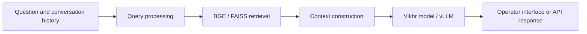

# Retrieval assistant for support operators

**BGE · FAISS · vLLM · FastAPI · Streamlit · Telegram**

A team implementation of a support-operator assistant combining document retrieval, local language-model inference and an interface for working with incoming questions.

## Architecture



## Explore the code

| Path | Responsibility |
| --- | --- |
| [`retriever.py`](retriever.py) | Retrieval, context construction and answer generation. |
| [`classifier.py`](classifier.py) | Query classification. |
| [`api.py`](api.py) | FastAPI `/predict` endpoint for a question and conversation history. |
| [`streamlit_app.py`](streamlit_app.py), [`pages/`](pages) | Support-operator interface. |
| [`bot.py`](bot.py), [`message_router.py`](message_router.py) | Telegram integration. |
| [`train_classifier.ipynb`](train_classifier.ipynb) | Classifier experiments. |

## Demonstration


## Local setup

The implementation requires the model weights, index/data files, GPU dependencies and paths referenced in the code. Review those settings in your own environment before starting the services.

```bash
uvicorn api:app --host 127.0.0.1 --port 1337
```

In a separate terminal:

```bash
streamlit run streamlit_app.py --server.port 1228
```

The [original Russian documentation](docs/original-readme.ru.md) includes the dependency list, Python usage and historical demo references. A complete model run has not been revalidated during this documentation refresh.

## Team and provenance

This fork preserves the original team's implementation. See the upstream repository linked by GitHub for the project's history; the public code is distinct from the private commercial deployments described in my profile.
